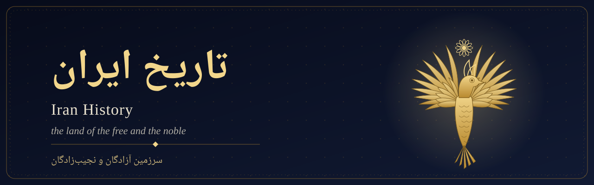
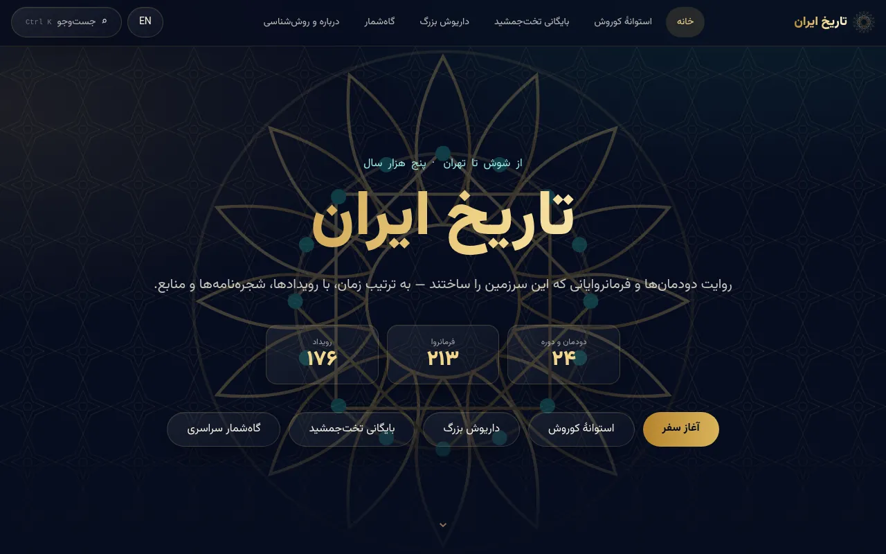
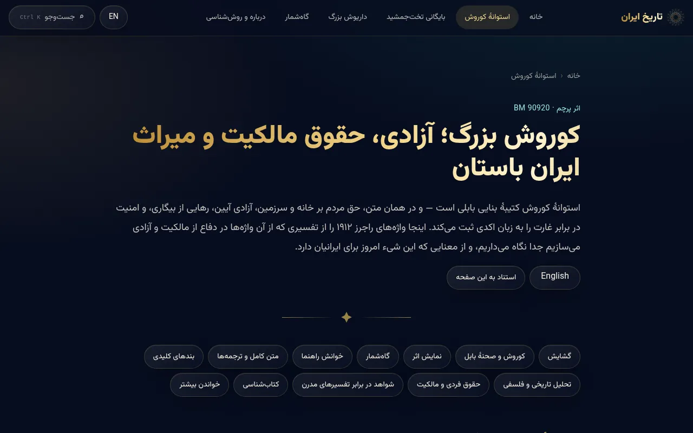
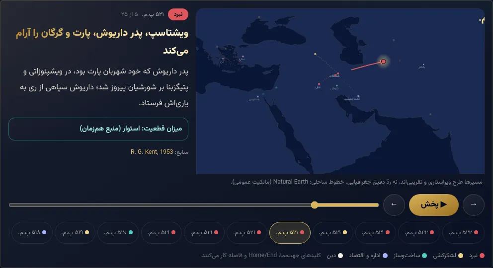
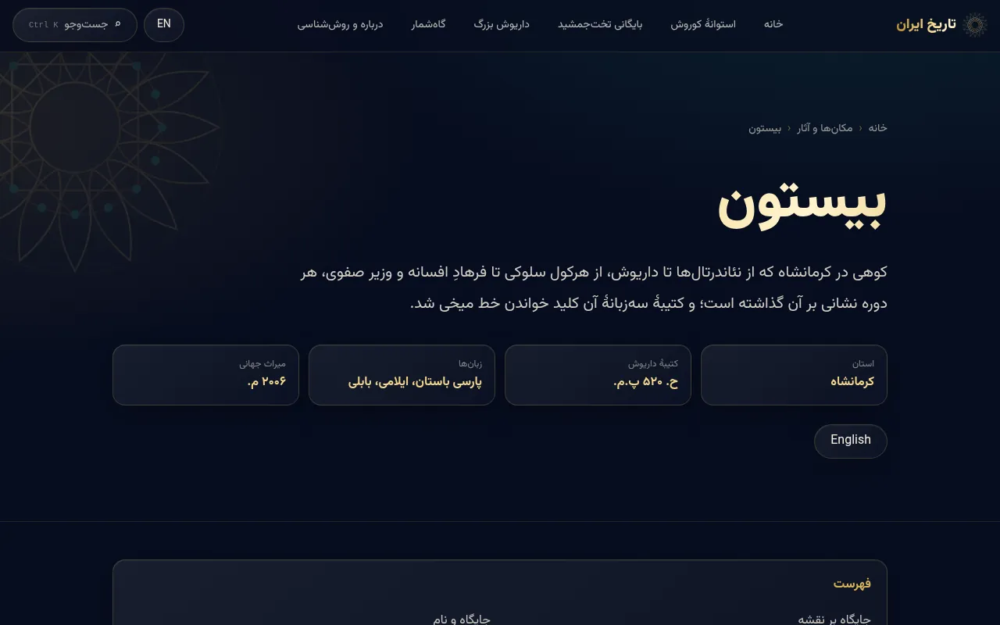
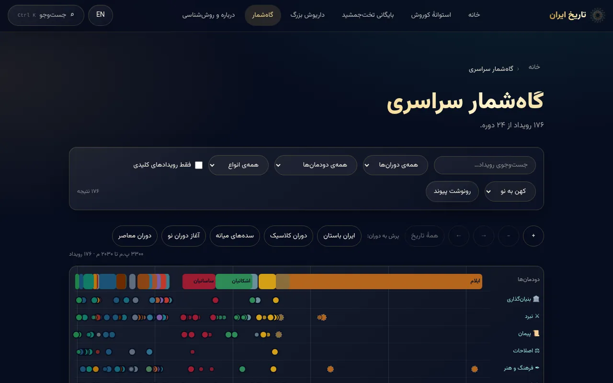
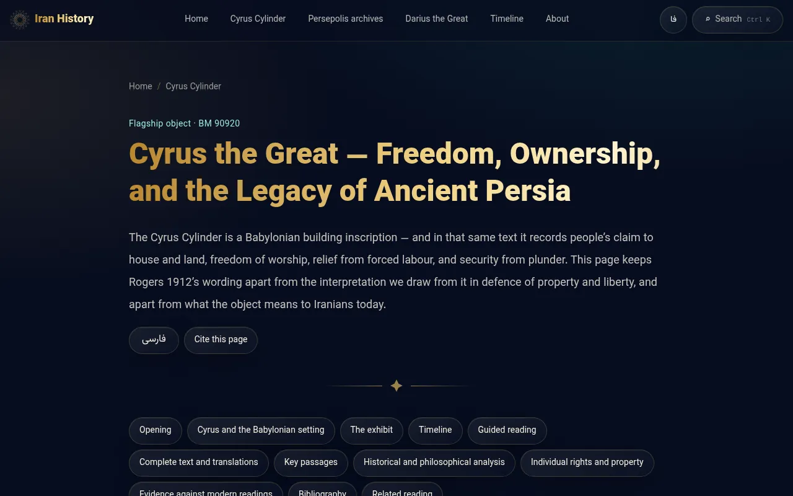
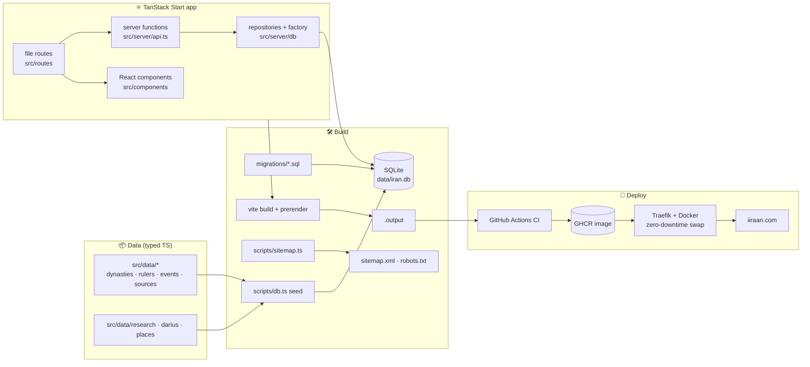

<p align="center">
  <a href="https://iiraan.com">
    <picture>
      <source media="(prefers-color-scheme: light)" srcset="docs/assets/banner-light.svg">
      
    </picture>
  </a>
</p>

<p align="center">
  <a href="https://github.com/falahatiali/Iran/actions/workflows/ci.yml"></a>
  <a href="https://iiraan.com"></a>
  <a href="./LICENSE"></a>
  
  
  
  
  
  
</p>

<p align="center">
  <b>A sourced, bilingual (Persian/English) reference to the history of Iran, from Elam to today.</b><br>
  <i>سرزمین آزادگان و نجیب‌زادگان</i> means “the land of the free and the noble”.
</p>

<p align="center"></p>

## Contents

- [What it is](#-what-it-is)
- [Mission and analytical lens](#-mission-and-analytical-lens)
- [Flagship features](#-flagship-features)
- [Screenshots](#-screenshots)
- [Sourcing and citation policy](#-sourcing-and-citation-policy)
- [Architecture](#-architecture)
- [Tech stack](#-tech-stack)
- [Project structure](#-project-structure)
- [Deployment overview](#-deployment-overview)
- [Roadmap](#-roadmap)
- [Acknowledgments](#-acknowledgments)
- [About the birds](#-about-the-birds)
- [Installation and local development](#-installation-and-local-development)
- [Contributing](#-contributing)
- [License](#-license)

## 🏛 What it is

**[iiraan.com](https://iiraan.com)** (site title: *تاریخ ایران*, “Iran History”) is a right-to-left Persian website with English pages for its flagship content. It covers:

- **24** dynasties and periods, from Elam to the Islamic Republic
- **213** rulers and leaders, each on one canonical page under dynasty → king, with family trees
- **176** dated events on a zoomable timeline
- Per-dynasty territory maps and bibliographies
- Deep dossiers on primary sources such as the Cyrus Cylinder and the Persepolis archives

Every page is server-rendered and prerendered, so it can be indexed and read without JavaScript.

## 🧭 Mission and analytical lens

The project's founding brief is in [docs/FOUNDATIONAL_PHILOSOPHY.md](./docs/FOUNDATIONAL_PHILOSOPHY.md).

- **Lens:** individual liberty and private property are the questions the project asks of the past: who owned what, who could keep it, and what protected it. The lens is a framework for analysis. It is never a licence to bend the evidence.
- **Three separate layers.** Data and UI keep these apart:
  1. **Historical evidence:** what the sources say, with citations.
  2. **Interpretation:** what it may mean, labelled as interpretation.
  3. **Modern meaning:** what the object or event means to Iranians today.
- **No fabrication:** no invented quotes, translations, images or 3D models.

## ✨ Flagship features

| | Feature | Where |
|---|---|---|
| 📜 | **Cyrus Cylinder reader**: line-by-line reader with deep links per line, full text from published translations, evidence badges, a “cite this page” button, and an embedded photogrammetry 3D model | [`/cylinder`](https://iiraan.com/cylinder) · [`/en/cylinder`](https://iiraan.com/en/cylinder) |
| 🏺 | **Persepolis archives and ration explorer**: the Fortification and Treasury tablets, with an interactive explorer of recorded rations | [`/archives`](https://iiraan.com/archives) · [`/en/archives`](https://iiraan.com/en/archives) |
| ⚔️ | **Darius the Great dossier**: an animated campaign map (play, scrub, keyboard controls) and a property-rights reading of the reign, on the canonical king page | [`/king/darius-i`](https://iiraan.com/king/darius-i) · [`/en/king/darius-i`](https://iiraan.com/en/king/darius-i) |
| ⛰️ | **Place pages**: Bisotun, with a map, layered history, licensed Commons photos with credits, and a bibliography | [`/place/bisotun`](https://iiraan.com/place/bisotun) · [`/en/place/bisotun`](https://iiraan.com/en/place/bisotun) |
| 🕰 | **Advanced timeline**: a dynasty band plus one lane per event type, zoom and pan (buttons, keyboard, Ctrl/⌘ + wheel, drag), era jumps, approximate/fixed date labels, and the view kept in the URL | [`/timeline`](https://iiraan.com/timeline) |
| 🔎 | **Search** (Ctrl/⌘ K): Persian normalisation (ی/ي, ک/ك, ZWNJ, diacritics), with places, kings, dynasties and events | every page |
| 🌐 | **Bilingual**: Persian RTL by default, English pages with hreflang alternates and a language toggle | |
| 🚀 | **SEO**: prerendered HTML, canonical URLs, OpenGraph, JSON-LD, sitemap and robots | |
| ♿ | **Accessibility**: semantic HTML, ARIA labels, keyboard support, `prefers-reduced-motion` respected | |

## 🖼 Screenshots

<table>
  <tr>
    <td width="50%"><a href="https://iiraan.com"></a><br><sub>Home</sub></td>
    <td width="50%"><a href="https://iiraan.com/cylinder"></a><br><sub>Cyrus Cylinder (fa)</sub></td>
  </tr>
  <tr>
    <td><a href="https://iiraan.com/king/darius-i"></a><br><sub>Darius I: animated campaign map</sub></td>
    <td><a href="https://iiraan.com/place/bisotun"></a><br><sub>Bisotun place page</sub></td>
  </tr>
  <tr>
    <td><a href="https://iiraan.com/timeline"></a><br><sub>Multi-lane timeline</sub></td>
    <td><a href="https://iiraan.com/en/cylinder"></a><br><sub>Cyrus Cylinder (en)</sub></td>
  </tr>
</table>

<sub>Screenshots of the live site taken on 30 October 2026.</sub>

## 📚 Sourcing and citation policy

- **Source hierarchy:**
  1. Primary sources and their scholarly editions, such as Kent's *Old Persian* (1953) and Schmitt's Bisotun edition (1991).
  2. Peer-reviewed reference works, such as *Encyclopædia Iranica*.
  3. Reputable secondary syntheses.
- **Every claim is citable.** Bibliographies sit with each dynasty, dossier and place, and the flagship pages have a “cite” button.
- **Quotations** are verbatim from published, attributable translations, with the edition named; out-of-copyright editions are preferred for full text.
- **Dates:** a date before 560 BCE is shown as approximate, a later one as fixed. This is a simple rule, explained on the About page.
- **Images** are used only with a verified licence (public domain, CC0, CC BY, CC BY-SA), with author and licence credited next to the image.
- **Corrections** are welcome; see [Contributing](#-contributing).

More detail: [About & Methodology](https://iiraan.com/about) · [docs/RESEARCH_LOG.md](./docs/RESEARCH_LOG.md) · [docs/IMPROVEMENT_LOG.md](./docs/IMPROVEMENT_LOG.md)

## 🏗 Architecture



## 🛠 Tech stack

| Layer | Technology |
|---|---|
| Framework | [TanStack Start](https://tanstack.com/start) + TanStack Router (React 19, SSR, prerender) |
| Language | TypeScript (strict) |
| Styling | Tailwind CSS 4 via `@tailwindcss/vite` |
| Motion | [Motion](https://motion.dev) |
| 3D | three.js, plus an embedded Sketchfab model |
| Database | SQLite through `@libsql/client` (repository/factory layer) |
| Server | Nitro (Node) |
| Font | Vazirmatn, self-hosted (OFL) |
| CI/CD | GitHub Actions → GHCR → Docker + Traefik |

## 🗂 Project structure

<details>
<summary>Show tree</summary>

```text
.
├── .github/workflows/      # ci.yml (lint, typecheck, test, build, image, deploy), deploy-manual.yml
├── deploy/                 # bootstrap and zero-downtime deploy scripts
├── docs/                   # FOUNDATIONAL_PHILOSOPHY, RESEARCH_LOG, IMPROVEMENT_LOG, IDEAS, assets/
├── migrations/             # SQL up/down migrations
├── public/                 # favicon, self-hosted fonts, media
├── scripts/                # db.ts (migrate/seed/reset/smoke), sitemap.ts
├── server/                 # Nitro error handler
├── src/
│   ├── components/         # Layout, Search, Timeline, FamilyTree, DynastyMap, …
│   │   ├── archives/       # ArchivesPage, RationExplorer
│   │   ├── cylinder/       # CylinderPage, CylinderReader, CylinderViewer, …
│   │   ├── featured/       # FeaturedDossier, CampaignMap
│   │   ├── place/          # PlacePage, placeRoute
│   │   └── timeline/       # TimelineChart, scale
│   ├── data/               # dynasties, rulers by era, sources, about, darius, featured, places, research
│   ├── lib/                # search schema, site URL, helpers (+ tests)
│   ├── routes/             # file routes: /, /timeline, /about, /cylinder, /archives,
│   │   │                   # /dynasty/$slug, /king/$slug, /place/$slug
│   │   └── en/             # English counterparts
│   ├── server/             # api.ts server functions, db/ repositories
│   └── styles/
├── Dockerfile · docker-compose.yml · docker-compose.prod.yml
├── DEPLOYMENT.md · ROADMAP.md · CONTRIBUTING.md · LICENSE
└── vite.config.ts · nitro.config.ts · tsconfig.json · eslint.config.js
```

</details>

## 🚢 Deployment overview

1. **CI** (`.github/workflows/ci.yml`) runs on every pull request and every push to `main`:
   - lint, typecheck, database smoke test and unit tests
   - a check that the sitemap refuses a missing site origin
   - the build, then checks on the prerendered pages
2. **Image:** on `main`, a Docker image is built, pushed to **GitHub Container Registry**, and scanned with Trivy.
3. **Deployment dry run:**
   - pulls the image and runs a health check against a mock environment
   - exercises rollback
4. **Production deploy:**
   - the new container passes its health check behind **Traefik** before the old one is retired, so there is no downtime
   - TLS comes from Let's Encrypt
   - `www` redirects to the apex domain with a 301
   - HSTS is enabled
5. **Post-deploy crawl:** checks sitemap and internal links, 404 handling, and key pages on the live site.

Full guide: [DEPLOYMENT.md](./DEPLOYMENT.md).

## 🗺 Roadmap

- [x] Cyrus Cylinder flagship page (fa/en)
- [x] Persepolis archives and ration explorer
- [x] Darius I dossier with animated campaign map
- [x] Place pages, starting with Bisotun
- [x] Multi-lane zoomable timeline
- [ ] **Cyrus the Great dossier**
- [ ] More place pages: **Persepolis**, **Pasargadae**, **Naqsh-e Rustam**
- [ ] **Liberty collection**: sourced primary texts on rights, law and property across eras
- [ ] **Property-rights research track**: land tenure, taxation and contracts, era by era
- [ ] Citations on every ruler and event, and data-level date uncertainty

The detailed plan (in Persian) is in [ROADMAP.md](./ROADMAP.md).

## 🙏 Acknowledgments

This project relies on the following, each credited on the pages where it is used:

- **The British Museum:** the Cyrus Cylinder (BM 90920) and related scholarship.
- **[Livius.org](https://www.livius.org/):** reference translations, with the underlying edition credited.
- **The Persepolis Fortification Archive project** and its published scholarship.
- ***Encyclopædia Iranica*** for many reference articles.
- **Wikimedia Commons contributors:** photos used under their stated licences, with each author credited.
- **[Natural Earth](https://www.naturalearthdata.com/):** public-domain coastlines for the maps.
- **[OpenStreetMap](https://www.openstreetmap.org/) contributors:** map embeds on place pages.
- **[@artfletch on Sketchfab](https://sketchfab.com/3d-models/the-cyrus-cylinder-f8d0a48f63f44bb49323b623853f6592):** the Cyrus Cylinder photogrammetry model (CC BY 4.0).
- **Saber Rastikerdar:** the [Vazirmatn](https://github.com/rastikerdar/vazirmatn) font (OFL).

## 🕊 About the birds

The banner shows a stylized **Homa** (هما), loosely inspired by the griffin-bird capitals of Persepolis and by Persian miniature painting. In Persian lore the Homa is a bird of good fortune; tradition holds that one whose head its shadow falls on is destined for kingship. The small divider shows a **Qoqnus** (ققنوس), the Persian name for the phoenix, which rises from its own ashes.

These are folklore and literary motifs, not historical claims. All artwork in `docs/assets/` was drawn for this repository as SVG.

<p align="center"></p>

## 💻 Installation and local development

**Requirements:** Node.js 20 and npm. Docker is optional.

```bash
git clone https://github.com/falahatiali/Iran.git
cd Iran
npm ci
npm run dev            # migrates + seeds SQLite, then serves http://localhost:3000
```

**Production build.** `VITE_SITE_URL` is required. The build refuses a missing value, an `http://` origin, or a placeholder.

```bash
VITE_SITE_URL=https://iiraan.com npm run build   # db reset → sitemap → vite build + prerender
npm start                                       # node .output/server/index.mjs
```

<details>
<summary>All scripts</summary>

| Script | Purpose |
|---|---|
| `npm run dev` | Dev server on port 3000 (runs migrate + seed first) |
| `npm run build` | Reset DB, generate sitemap, build and prerender |
| `npm start` | Run the built server |
| `npm run lint` | ESLint |
| `npm run typecheck` | `tsc --noEmit` |
| `npm test` | Unit and data-integrity tests (`node:test` via tsx) |
| `npm run db:migrate` / `db:rollback` / `db:seed` / `db:reset` / `db:smoke` | Database lifecycle |
| `npm run generate-routes` | Regenerate `src/routeTree.gen.ts` after adding routes |
| `npm run sitemap` | Generate `public/sitemap.xml` and `robots.txt` |

</details>

**With Docker:** `docker compose up --build`. See [DEPLOYMENT.md](./DEPLOYMENT.md) for production.

**Quality gates.** Run all of these before every PR; CI runs the same steps:

```bash
npm run lint && npm run typecheck && npm test && VITE_SITE_URL=https://iiraan.com npm run build
```

## 🤝 Contributing

Corrections and contributions are welcome. The full rules are in **[CONTRIBUTING.md](./CONTRIBUTING.md)**. In short:

### Rules

1. **Every claim needs a citable source:** edition or article, plus page or section.
2. **No invented quotes.** Quote verbatim only from published translations, and cite them.
3. **Keep the three layers separate:** evidence, interpretation and modern meaning.
4. **Images:** only public domain, CC0, CC BY or CC BY-SA, with the licence checked and the author credited.
5. **Page structure:** one canonical page per king under dynasty → king; places and topics get dedicated pages.
6. **No secrets, keys, server IPs or private paths** in commits. The repository is public.
7. **Conventional Commits**, e.g. `feat(place): add Pasargadae`, `fix(data): correct Gotarzes II dates`.
8. **Be respectful.** Debate sources, not people.

### Workflow

1. Fork the repo, then create a branch such as `feat/pasargadae` or `fix/gotarzes-date`.
2. Make the change and add or update tests for data changes.
3. Run lint, typecheck, test and build, with `VITE_SITE_URL` set for the build.
4. Open a PR that lists your sources.
5. CI must pass and a review is required before merge.

**Found a factual error?** Open an issue with the page URL, the claim, the correct reading, and the source (with page or section).

## 📄 License

[MIT](./LICENSE). Third-party texts, images and models keep their own licences, credited on the pages where they appear.
